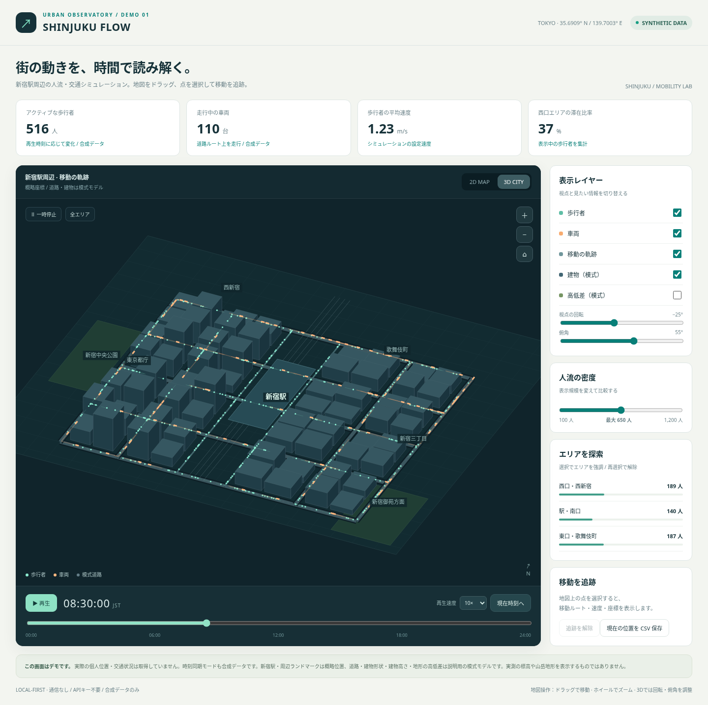

# SHINJUKU FLOW — 新宿人流ラボ

新宿駅周辺を舞台に、歩行者と車両が時間とともに移動するインタラクティブなデモです。人流・交通・道路・建物・高低差は合成／模式モデルです。実際の個人位置や交通状況は取得しません。



## 開き方

**[index.html](index.html) をダウンロードし、Chrome、Edge、Firefox などのブラウザで開いてください。** GitHub 上では `index.html` を選び、右上の「Download raw file」から保存できます。保存した HTML をダブルクリックすると動作します。HTML 1ファイルだけで動き、インストール・API キー・サーバー・ネット接続は不要です。

GitHub のファイル表示ページはソースコードを表示します。[GitHub Pages公開用のワークフロー](../../docs/github-pages.md) も用意しています。Pagesの有効化とデプロイが完了すると、HTMLのダウンロードなしで利用できます。公開状態はワークフローのdeployジョブで確認してください。また、このデモは Grafana 内に配置したパネルではなく、アニメーションと立体表示を優先した独立画面です。既存 Grafana ダッシュボードは変更していません。

## 試してみる

1. 初期状態では朝8時から10倍速で移動します。緑の点が歩行者、オレンジの点が車両です。
2. **停止**して時刻バーを朝・昼・夜へ動かすと、位置と人数が変化します。時刻バーを動かすと停止するので、そのまま比較できます。**再生**で再開します。
3. **3D CITY** に切り替え、回転と俯角を変えます。建物は設定した高さを持つ模式モデルです。
4. 地図をドラッグ／ホイールで移動・拡大します。右上のホームボタンで視点を戻せます。地図にフォーカスすると矢印キーと `+` / `-` でも操作できます。
5. 点をクリック／タップするとルート、速度、緯度経度を表示します。追跡中のルートは黄色で強調されます。Esc または「追跡を解除」で解除します。
6. 歩行者・車両・軌跡・建物・高低差のレイヤーを切り替えます。エリアを選ぶと該当エリアを強調します。エリア選択は絞り込みではなく、人数の合計は変わりません。
7. **現在時刻へ**で、日本時間の時計と同じ速さで合成データを動かします。実際のリアルタイム人流を取得する機能ではありません。時刻バーを動かすと時刻同期が解除されます。
8. **現在の位置を CSV 保存**すると、その時刻にアクティブな全歩行者・車両の位置を保存できます。非表示のレイヤーも CSV には含まれます。

## デモのモデル

- 歩行者は最大100〜1,200人。朝・夕方のピークを持つ時間帯係数でアクティブ人数を決めます。
- 車両は最大140台のプールから時間帯に応じて有効化します。
- 各エージェントは固定シードで生成した経路・開始位置・速度を持ちます。同じ人数・時刻なら、同じ移動を再現できます。午前0時で1日をループします。
- 速度は歩行者0.75〜1.70 m/s、車両5〜10 m/s。移動は道路／歩行路の折れ線上で、信号制御・衝突回避・駅内部の通路はモデル化していません。
- 人数、平均速度、エリア滞在比率は、その時刻の合成歩行者を集計した指標です。実測値・予測値・実際の混雑率ではありません。
- 中心座標は新宿駅付近。ローカル平面座標から緯度経度へ近似変換します。道路網・建物形状は実在の形状を再現していません。地図の経路探索には使えません。
- 3D は Canvas 2D に立体座標を投影した建物の押し出し表示です。写真測量モデル、WebGL、実測建物高さではありません。
- 高低差は説明用の数学モデルです。新宿周辺の標高や山の高さではありません。実測の地形・道路・建物データの取り込み方針は [設計とデータ仕様](../../docs/shinjuku-flow.md) を参照してください。

## 開発・検証

```bash
# リポジトリのルートで実行
npm ci --ignore-scripts --no-audit --no-fund
npm run verify:shinjuku
```

Chromium は `/usr/bin/chromium` を使います。別の場所にある場合は `CHROMIUM_PATH` を指定してください。検証は HTML をブラウザへ直接読み込み、外部通信なしで操作します。管理環境の `file://` 閲覧制限には依存しません。ユーザーのローカルブラウザでのファイル起動は別途行ってください。

アニメーション、停止、時刻による位置再現と人数変化、選択、レイヤー、エリア強調、3D・回転・俯角・高低差、視点操作、人数設定、CSV の保存内容、JST 時刻同期、再生速度、スマホ幅、JavaScript エラー・外部通信の13項目を検証します。画像と結果は `.local/browser/shinjuku-flow/` に保存します。README の画像は確認済みの合成データ画面です。
